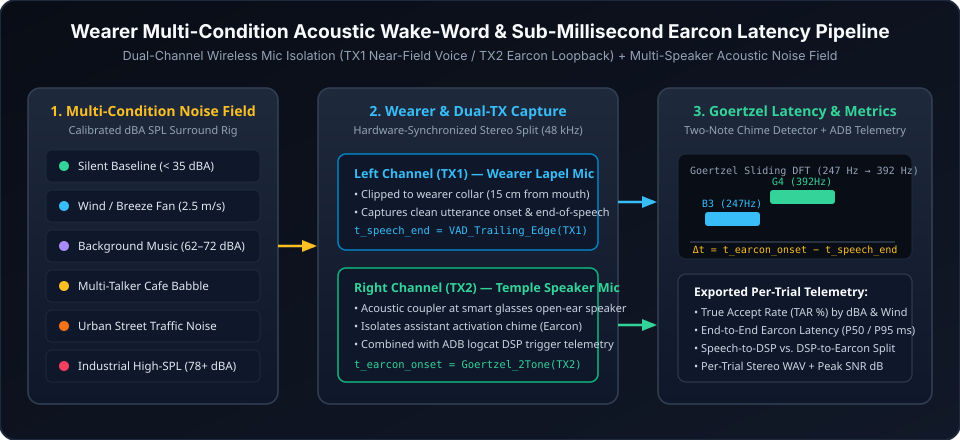

# XR Wake-Word Wearer Benchmark & Acoustic Earcon Latency Suite

[](LICENSE)
[](https://www.python.org/)
[](#sub-millisecond-earcon-latency-engine)
[](#distributed-multi-node-noise-orchestration)

A full-stack acoustic evaluation and latency benchmarking suite for benchmarking **on-device voice wake-word detection** and **end-to-end voice assistant earcon response latency** on XR Smart Glasses and wearable AI form factors under controlled multi-condition acoustic environments.



---

## Key Capabilities

1. **Multi-Condition Acoustic Test Matrix (16-Step Standard Protocol)**
   - **Silent Baseline (`< 35 dBA`)**: Pure near-field speech baseline across normal, soft, and loud vocal effort levels.
   - **Laminar Wind / Breeze (`2.5 m/s`)**: Evaluates mechanical wind-port turbulence rejection and high-pass beamforming resilience.
   - **Background Music (`62–72 dBA`)**: Tests spectral subtraction and false-negative resilience against dynamic musical transients.
   - **Multi-Talker Cafe Babble**: Assesses competing-speech rejection when background talkers overlap the target wake-word band.
   - **Urban Traffic & High-SPL Industrial (`78+ dBA`)**: Measures wake-word recall under low signal-to-noise ratio (SNR) conditions.

2. **Hardware-Synchronized Dual-Channel Wireless Microphone Capture (`TX1` / `TX2`)**
   - Uses a single stereo USB receiver (e.g., DJI Mic / Rode Wireless Pro in Split Stereo Mode at 48 kHz) to eliminate clock drift between channels:
     - **Left Channel (`TX1` — Wearer Lapel Mic)**: Clipped 15 cm from the wearer's mouth to capture clean vocal energy and compute exact **end-of-speech (`t_speech_end`)** via trailing-edge Voice Activity Detection (VAD).
     - **Right Channel (`TX2` — Temple Speaker Acoustic Coupler)**: Positioned adjacent to the smart glasses' open-ear temple speaker to isolate the acoustic assistant activation chime (**Earcon**) and measure **true user-perceived response latency**.

3. **Sub-Millisecond Goertzel Earcon Onset Detector & ADB Telemetry Fusion**
   - **Acoustic Earcon Engine (`frontend/earcon_detector.js`)**: Implements a sliding-window Goertzel DFT filter bank tuned to two-note ascending assistant chimes (e.g., `B3 247 Hz → G4 392 Hz`) with harmonic rejection (`494 Hz`, `741 Hz`), spectral flatness guards, and two-stage confirmation.
   - **Android `logcat` Bridge (`backend/adb_monitor.py`)**: Streams real-time DSP wake-word trigger events over USB or Wi-Fi ADB (`HotwordDetector`, `VoiceInteractionService`, `SoundTrigger`), decomposing total latency into:
     $$\Delta t_{\text{total}} = \underbrace{(t_{\text{DSP}} - t_{\text{speech\_end}})}_{\text{On-Device Wake-Word Detection}} + \underbrace{(t_{\text{earcon}} - t_{\text{DSP}})}_{\text{Audio Pipeline & Chime Render}}$$

4. **Distributed WebRTC Multi-Node Noise Field (`PeerJS`)**
   - Synchronizes calibrated background noise playback (Music, Babble, Traffic, Industrial) across remote laptops, tablets, or surround soundbars via WebRTC data channels (`tester.html` ↔ `speaker.html`).

---

## Repository Structure

```text
xr-wakeword-wearer-benchmark/
├── assets/
│   └── wearer_acoustic_pipeline.svg       # Dual-TX capture & Goertzel latency architecture diagram
├── backend/
│   ├── server.py                          # FastAPI orchestration server, WAV recorder & CSV logger
│   ├── adb_monitor.py                     # Asynchronous Android ADB logcat wake-word listener
│   ├── audio_Reactive_Controller.py       # Real-time ambient SPL dBA & mic level monitor
│   └── zaber_stage.py                     # Optional rotary stage interface for hybrid test suites
├── configs/
│   └── gemini_hotwords_suite.json         # 16-step Wearer multi-condition test protocol definition
├── frontend/
│   ├── tester.html                        # Operator test console, real-time spectrograms & trial HUD
│   ├── tester.js                          # Trial state machine, dual-TX WebAudio graph & CSV export
│   ├── earcon_detector.js                 # Sliding Goertzel DFT chime onset detector (247Hz -> 392Hz)
│   ├── wearer_guide.html                  # Participant-facing teleprompter & vocal pace cue display
│   ├── speaker.html                       # Remote WebRTC noise field playback node
│   ├── speaker.js                         # Calibrated ambient noise generator & gain controller
│   └── style.css                          # Dark-mode acoustic lab UI stylesheet
├── start_wearer_study.sh                  # One-command launcher for the Wearer benchmark suite
├── start_testbed.sh                       # Full testbed launcher with ADB device check
├── requirements.txt                       # Python dependencies
└── LICENSE                                # MIT License
```

---

## Quick Start

### 1. Install Dependencies

```bash
python3 -m venv .venv
source .venv/bin/activate
pip install -r requirements.txt
```

### 2. Hardware Setup (Dual-TX Stereo Split)

1. Connect the **Dual-Channel Wireless Microphone Receiver (RX)** to the host computer via USB-C and set the receiver to **Stereo Split Mode**:
   - **TX1 (Left Channel)**: Clip to the participant's collar (~15 cm below the mouth).
   - **TX2 (Right Channel)**: Attach to the temple arm of the smart glasses near the acoustic speaker grill.
2. *(Optional)* Connect the Android XR smart glasses via USB or wireless ADB (`adb devices`) to log hardware DSP trigger timestamps alongside acoustic earcon detection.

### 3. Launch the Benchmark Suite

```bash
./start_wearer_study.sh
```

Then open in Google Chrome or Microsoft Edge:
- **Operator Console**: `http://localhost:8000/tester.html`
- **Participant Teleprompter**: `http://localhost:8000/wearer_guide.html`
- **Remote Noise Speaker Node**: `http://localhost:8000/speaker.html`

---

## Exported Telemetry Schema

Each completed session exports a timestamped CSV report and per-trial stereo WAV captures (`logs/`):

| Column | Description |
| :--- | :--- |
| `trial_id` | Sequential step index (`1..16`) in the Wearer protocol |
| `condition_name` | Acoustic environment (`Silent`, `Wind`, `Music`, `Babble`, `Traffic`, `Industrial`) |
| `noise_level_dba` | Measured ambient background SPL (dBA) during the trial |
| `wakeword_detected` | Boolean (`1`/`0`) indicating whether the wake-word triggered |
| `detection_source` | Trigger source (`EARCON_MIC_TX2`, `ADB_LOGCAT`, or `MANUAL_OVERRIDE`) |
| `latency_ms` | End-to-end latency (ms) from wearer speech trailing edge (`TX1`) to earcon onset (`TX2`) |
| `wearer_peak_db` | Peak vocal level (dBFS) measured on `TX1` |
| `snr_db` | Effective Signal-to-Noise Ratio (dB) between wearer voice and ambient floor |

---

## Related Open-Source Repositories

- **[`xr-rotary-stage-cad-fixtures`](https://github.com/Hekim98/xr-rotary-stage-cad-fixtures)** — Parametric 3D CAD Fixtures (`.step`, `.stl`, `.obj`) and Zaber `X-RSW60A` Rotary Stage Metrology Kit.
- **[`xr-bystander-spatial-rig`](https://github.com/Hekim98/xr-bystander-spatial-rig)** — 360° Spatial Bystander False-Trigger & Polar Directivity Evaluation Rig.

---

## License

Released under the [MIT License](LICENSE).
